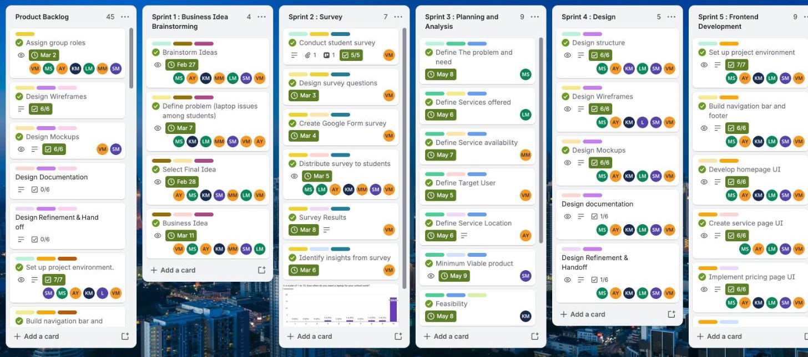
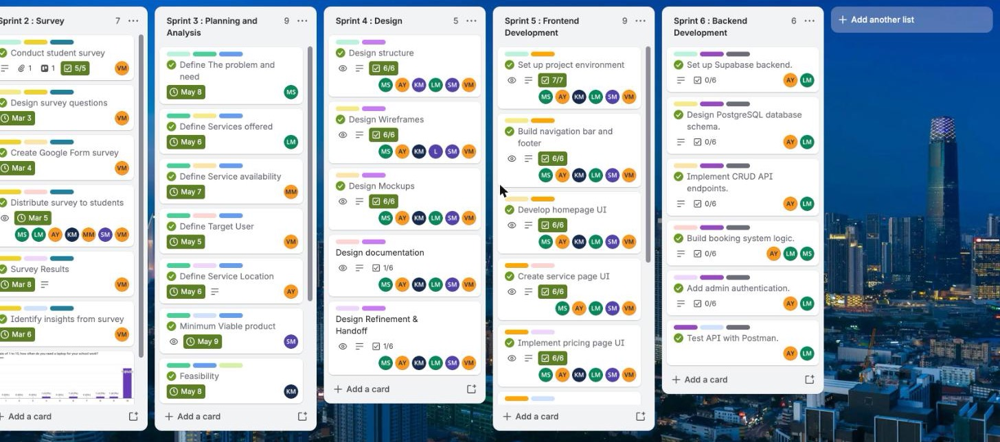

# lisakhanyajonga-portfolio
My GitHub Portfolio

# Lisakhanya Tinae Jonga

 **Cape Town, Western Cape**  
 **Email:** 222430575@mycput.ac.za
 **LinkedIn:** [Lisakhanya Jonga](https://www.linkedin.com/in/lisakhanya-jonga-0b5b23325)

---

## Professional Summary

Final-year **ICT: Applications Development** student with a broad academic background in software development, information systems, networking, and digital technologies.

Equipped with strong **problem-solving, analytical, and communication skills** through project-based learning. Motivated to apply technical and theoretical knowledge in a practical environment while continuing to grow in dynamic and challenging settings.

---

## Education

**Cape Peninsula University of Technology**  
Diploma in ICT: Applications Development  
 2024 – 2026

**Khwezilomso Comprehensive School**  
National Senior Certificate  
 2021

---

## Technical Skills

- **Programming:** Java, JavaScript, PHP, Python  
- **Web Development:** HTML, CSS  
- **Database:** SQL  
- **Operating Systems:** Linux  
- **Tools:** Microsoft Office Suite, Power BI  
- **Other:** Cybersecurity fundamentals

---

## Work Experience

### OceanHub Africa Hackathon – Assistant (2025)

- Provided technical support to hackathon participants  
- Assisted with event logistics and coordination  
- Ensured smooth event operations

### AfriHack Connect Hackathon – Participant (2025)

- Collaborated in a team to develop a software solution under tight deadlines  
- Applied **coding, design thinking, and problem-solving skills**  
- Contributed to delivering a working prototype

### McDonald's – Crew Member (2022 – 2023)

- Delivered customer service in a fast-paced environment  
- Worked effectively within a team  
- Developed strong **communication and teamwork skills**

---

## References

**Lungile Ntuli**  
AfriHack Connect – CTO  
Email: lungilentuli@empirasglobalacademy.com  

**Thando Mazomba**  
OceanHub Venture – Development Manager  
Email: thando@oceanhub.africa

## Mock Interview Video 
<video width="100%" height="auto" controls>
  <source src="mock-interview-final.mp4" type="video/mp4">
  https://github.com/LisaTee-J/lisakhanyajonga-portfolio/blob/main/video-file.mp4
 Click here to view 
</video>

##  Reflections

### Reflection 1: Coding in Markdown 

**Situation**  
As part of my PRP370 Project Presentation module at CPUT, I was required to create a complete digital portfolio using GitHub Flavoured Markdown (GFM). Before this assessment, I had only used word processors like Microsoft Word and had no experience with Markdown syntax.

**Task**  
I needed to learn Markdown from scratch and use it to structure my entire professional portfolio, including my CV, video embedding, and all reflections. The portfolio had to be clean, readable, and professionally formatted without using traditional word processing tools.

**Action**  
I started by reading the official GitHub Markdown documentation and practicing basic syntax on Youtube. I learned to use:
- `#` for headings and `##` for subheadings to create a clear hierarchy
- `-` for bullet points in my skills and experience sections
- `**bold**` and `*italic*` for emphasis
- `[link text](URL)` for hyperlinks
- `---` for horizontal rules to separate sections
- Backticks (`` ` ``) for code formatting
- HTML `<video>` tags for embedding my mock interview video

I created a table of contents using anchor links, organized my CV into logical sections, and used proper spacing to improve readability. I also learned to use GitHub's preview feature to check my formatting before committing changes.

**Result**  
I successfully built a fully formatted, professional-looking portfolio using only plain text Markdown. The final result is:
- Easy to read on both GitHub and GitHub Pages
- Faster to edit than a Word document
- Version-controlled through Git
- Responsive and works on mobile devices
- Professionally formatted with clear section separation

This experience taught me a valuable developer skill. I now understand why Markdown is the standard for documentation on platforms like GitHub, Stack Overflow, and Reddit. I can confidently use Markdown for future projects, README files, and technical documentation.

---

### Reflection 2: Mock Interview Video Experience 

**Situation**  
As part of my work readiness portfolio, I had to record a mock job interview video. This simulated a real interview for an entry-level ICT / Applications Development role. I have limited experience with video recordings and on-camera presentations, which made this challenging.

**Task**  
My goal was to present myself as a confident, articulate, and professional candidate. I needed to:
- Answer common interview questions effectively
- Demonstrate my communication and problem-solving skills
- Showcase my technical knowledge and academic background
- Create a video that would impress potential employers

**Action**  
I prepared thoroughly using the following steps:

1. **Research:** I watched YouTube videos on common ICT interview questions and best practices
2. **Preparation:** I wrote down key talking points about:
   - My education at CPUT
   - My hackathon experiences (OceanHub Africa and AfriHack Connect)
   - My technical skills in Java, Python, PHP, and MySQL
   - My teamwork experience at McDonald's
3. **Practice:** I rehearsed answers out loud multiple times, focusing on:
   - Using the STAR method for behavioural questions
   - Speaking clearly and at a moderate pace
   - Avoiding filler words like "um", "uh", and "like"
4. **Technical setup:** 
   - Set up my phone on a tripod at eye level
   - Found a quiet, well-lit room with a neutral background
   - Tested audio levels to ensure clear sound
   - Recorded multiple takes and chose the best one

**Result**  
The final video shows me as a confident and well-prepared candidate. Key outcomes include:
- Clear, articulate answers to all interview questions
- Professional appearance and positive body language
- Effective demonstration of my technical and soft skills
- A portfolio piece I can share with real employers

Reviewing the recording helped me identify areas for improvement, such as maintaining more consistent eye contact with the camera. This experience significantly improved my interview readiness and reduced my anxiety about real job interviews. I now have a reusable resource for job applications.

---

### Reflection 3: Using GitHub Pages (STAR Method)

**Situation**  
After creating my Markdown portfolio in a GitHub repository, I needed to deploy it to a live, publicly accessible website. I had never used GitHub Pages before and was unsure how static site hosting worked.

**Task**  
The goal was to publish my portfolio so that:
- It could be accessed via a unique URL (e.g., `https://username.github.io/repository-name/`)
- The URL could be submitted on Blackboard for assessment
- The site would automatically update when I pushed changes to my repository
- The deployment process had to be completed without additional cost or external hosting services

**Action**  
I followed these steps to deploy my portfolio:

1. Navigated to my repository on GitHub.com
2. Clicked on the **"Settings"** tab (near the top right of the page)
3. Scrolled down to find **"Pages"** in the left sidebar under "Code and automation"
4. Under the "Branch" section, I changed the source from "None" to **"main"**
5. Left the folder as **"/ (root)"** since my `README.md` was in the main directory
6. Clicked the **"Save"** button
7. Waited approximately 1-2 minutes for GitHub to build and deploy my site
8. Refreshed the page until I saw the message: *"Your site is live at `https://username.github.io/repo-name/`"*
9. Clicked the link to verify my portfolio was displaying correctly
10. Tested the link on both desktop and mobile devices

**Result**  
My portfolio is now successfully deployed and live on the internet at a professional, shareable URL. Key achievements:
- **Free hosting:** GitHub Pages provided this at no cost
- **Automatic updates:** Any future changes I push to my `README.md` automatically update the live site
- **Custom URL:** I can optionally add a custom domain later
- **Professional presentation:** The portfolio looks identical to my local Markdown preview

---

# Agile Project Portfolio: PC Revival

PC Revival is a group project to build a website for affordable laptop repairs and refurbished laptop sales for students. I joined the team later, from another group. The evidence below comes from the team's own Trello board and Agile Team Charter. Each section has a short reflection.

**Trello board:** [PC Revival – Project Progress](https://trello.com/b/68sMqKP5/pc-revival-project-progress)

## Contents
1. [Agile Team Charter](#1-agile-team-charter)
2. [User Stories and Tasks](#2-user-stories-and-tasks)
3. [Product Backlog](#3-product-backlog)
4. [Sprint Backlog](#4-sprint-backlog)
5. [Agile Logbook](#5-agile-logbook)

---

## 1. Agile Team Charter

### Evidence
Full charter (whiteboard export): [PC-Revival-Team-Charter.pdf](PC-Revival-Team-Charter.pdf)

| Section | Summary |
|---|---|
| **Purpose** | Collaboratively design, develop, test and deliver a reliable, user-friendly system that supports affordable laptop repairs and refurbished laptop sales |
| **Values** | Collaboration, Accountability, Respect, Quality, Continuous Improvement |
| **Decision making** | Discuss the issues, evaluate options, seek consensus, vote when necessary, respect roles (the Product Owner prioritises the backlog, developers decide technical implementation), record outcomes in the product backlog |
| **Conflict resolution** | Address the issue respectfully, focus on the problem, explore solutions, mediation by the Scrum Master, escalate to the project supervisor, review the outcome |
| **Workflow and communication** | Break requirements into user stories and tasks, prioritise by importance and deadline, demo completed features, run retrospectives. WhatsApp for quick updates, GitHub for source code, Trello for tasks and backlog |
| **Team goals** | A functional website for repairs and refurbished sales, a system for repair requests, a database for customers, requests, inventory and services, and a student-friendly interface |
| **Success metrics** | Core features meet acceptance criteria, database stores and retrieves records, planned tests complete with critical defects fixed, test users complete main tasks |
| **Roles** | Brainstorming, survey and requirements, planning and analysis, system design, frontend development, backend development (Supabase) |

### Reflection
**Situation:** I joined PC Revival after the charter had been agreed, having worked in a different group before. I joined during Sprint 5 (Frontend Development), when the team was already building the website pages.
**Task:** I had to learn how the team worked and fit in with its agreements.
**Action:** I read the charter and followed its decision-making and communication rules, using Trello for tasks and WhatsApp for updates. I also joined the team's WhatsApp and Trello so I could pick up tasks, and my own work was fixing bugs, adding card payments at checkout and connecting the project to the backend.
**Result:** The charter gave me a clear picture of roles and expectations, so I could contribute without disrupting the team. It showed me that a charter is useful for new members as well as for the team that wrote it.

---

## 2. User Stories and Tasks

### Evidence
User stories written from the tasks on the Trello board. Each links to the board's task list.

| # | User story | Tasks (Trello) |
|---|---|---|
| US1 | As a student, I want to see which repair and refurbished laptop services are offered, so that I can choose what I need | Define services offered, Create service page UI |
| US2 | As a student, I want to see clear prices, so that I can afford the service | Implement pricing page UI, Display pricing/services dynamically from DB |
| US3 | As a student, I want to book a repair online, so that I do not have to visit without an appointment | Build contact/booking page UI, Build booking system logic, Test booking workflow end-to-end |
| US4 | As a student, I want the site to work on my phone, so that I can use it anywhere | Test responsive design, Build navigation bar and footer |
| US5 | As a visitor, I want to learn who the business is, so that I can trust it | Develop about page UI, Develop homepage UI |
| US6 | As an admin, I want to log in securely, so that only authorised people manage bookings | Add admin authentication, Validate inputs and secure endpoints |
| US7 | As an admin, I want repair requests and inventory stored in a database, so that I can manage them | Set up Supabase backend, Design PostgreSQL database schema, Implement CRUD API endpoints |
| US8 | As the team, we want the system tested before launch, so that critical defects are fixed | Run unit and integration tests, Test API with Postman, Document test results |
| US9 | As the team, we want the site live on the internet, so that students can use it | Select hosting platform, Deploy frontend with Vercel, Deploy backend with Supabase |
| US10 | As a customer, I want to pay by card at checkout, so that I can pay for a repair or laptop online | Integrate online payments, Connect frontend forms to backend API |

### Reflection
**Situation:** The team's requirements had to be turned into work that could be tracked.
**Task:** Describe features from the user's point of view and split them into tasks.
**Action:** I studied how the board's tasks map to user stories. My own work was US3, US6, US7 and a new story I added, US10, for card payments: fixing bugs, adding card payments at checkout and connecting the project to the backend.
**Result:** Writing "As a… I want… so that…" kept the work focused on the student, and the task breakdown made progress easy to see.

---

## 3. Product Backlog

### Evidence
The full backlog is the first list on the Trello board (45 cards). Cards are grouped by the sprint they belong to.

| Sprint | Backlog item | Status |
|---|---|---|
| Documentation / Other | Assign group roles | Done |
| Documentation / Other | Final Report: Deliverable 1 (PC Revival) | Done |
| Documentation / Other | Final report: Deliverable 2 (PC Revival) | Done |
| Sprint 4 | Design Wireframes | Done |
| Sprint 4 | Design Mockups | Done |
| Sprint 4 | Design Documentation | Not yet done |
| Sprint 4 | Design Refinement & Handoff | Not yet done |
| Sprint 5 | Set up project environment. | Done |
| Sprint 5 | Build navigation bar and footer. | Done |
| Sprint 5 | Develop homepage UI. | Done |
| Sprint 5 | Create services page UI. | Done |
| Sprint 5 | Implement pricing page UI. | Not yet done |
| Sprint 5 | Design about page UI. | Done |
| Sprint 5 | Build contact/booking page UI. | Done |
| Sprint 5 | Test responsive design. | Done |
| Sprint 5 | Review against mockups. | Not yet done |
| Sprint 6 | Run unit & integration tests. | Not yet done |
| Sprint 6 | Document backend setup. | Not yet done |
| Sprint 7 | Connect frontend forms to backend API. | Not yet done |
| Sprint 7 | Display pricing/services dynamically from DB. | Not yet done |
| Sprint 7 | Test booking workflow end‑to‑end. | Not yet done |
| Sprint 7 | Validate inputs and secure endpoints. | Not yet done |
| Sprint 7 | Run unit tests (frontend). | Not yet done |
| Sprint 7 | Run integration tests (backend). | Not yet done |
| Sprint 7 | Fix bugs and optimize performance. | Not yet done |
| Sprint 7 | Document test results. | Not yet done |
| Sprint 8 | Select hosting platform. | Not yet done |
| Sprint 8 | Deploy frontend build with Vercel. | Not yet done |
| Sprint 8 | Deploy backend API with Supabase. | Not yet done |
| Sprint 8 | Connect live database. | Not yet done |
| Sprint 8 | Register and configure domain. | Not yet done |
| Sprint 8 | Install SSL certificate. | Not yet done |
| Sprint 8 | Test booking flow in production. | Not yet done |
| Sprint 8 | Launch marketing campaign. | Not yet done |
| Sprint 8 | Collect first user feedback. | Not yet done |
| Sprint 9 | Integrate online payments. | Not yet done |
| Sprint 9 | Build student membership system. | Not yet done |
| Sprint 9 | Add laptop rental module. | Not yet done |
| Sprint 9 | Enhance booking with calendar + notifications. | Not yet done |
| Sprint 9 | Optimize performance and speed. | Not yet done |
| Sprint 9 | Expand to other campuses. | Not yet done |
| Sprint 9 | Collect feedback and analytics. | Not yet done |
| Sprint 9 | Iterate based on student needs. | Not yet done |

Sprints 7 to 9 (Integration and Testing, Deployment and Launch, Post Launch and Growth) are planned in the backlog and not yet started.

### Reflection
**Situation:** All the project's work needed to live in one prioritised list.
**Task:** Understand and follow the backlog so I knew what was planned and what came next.
**Action:** I read the backlog, saw how items were labelled by sprint and day, and checked which were done. The items I worked on were Connect frontend forms to backend API, Fix bugs and optimize performance, and Integrate online payments (card payments at checkout).
**Result:** A backlog gave the team one source of truth and let the Product Owner reprioritise as needed.

---

## 4. Sprint Backlog

### Evidence
Each sprint is a list on the Trello board.

#### Sprint 1 : Business Idea Brainstorming

| Task | Due | Status |
|---|---|---|
| Brainstorm Ideas | 2026-02-27 | Done |
| Define problem (laptop issues among students) | 2026-03-07 | Done |
| Select Final Idea | 2026-02-28 | Done |
| Business Idea | 2026-03-11 | Done |

#### Sprint 2 : Survey

| Task | Due | Status |
|---|---|---|
| Conduct student survey | - | Done |
| Design survey questions | 2026-03-03 | Done |
| Create Google Form survey | 2026-03-04 | Done |
| Distribute survey to students | 2026-03-05 | Done |
| Survey Results | 2026-03-08 | Done |
| Identify insights from survey | 2026-03-06 | Done |

#### Sprint 3 : Planning and Analysis

| Task | Due | Status |
|---|---|---|
| Define The problem and need | 2026-05-08 | Done |
| Define Services offered | 2026-05-06 | Done |
| Define Service availability | 2026-05-07 | Done |
| Define Target User | 2026-05-05 | Done |
| Define Service Location | 2026-05-06 | Done |
| Minimum Viable product | 2026-05-09 | Done |
| Feasibility | 2026-05-08 | Done |
| Define services (repair, upgrade, refurbished laptops) | 2026-03-08 | Done |
| Develop value proposition | 2026-03-12 | Done |

#### Sprint 4 : Design

| Task | Due | Status |
|---|---|---|
| Design structure | - | Done |
| Design Wireframes | - | Done |
| Design Mockups | - | Done |
| Design documentation | - | Not yet done |
| Design Refinement & Handoff | - | Not yet done |

#### Sprint 5 : Frontend Development

| Task | Due | Status |
|---|---|---|
| Set up project environment | - | Done |
| Build navigation bar and footer | - | Done |
| Develop homepage UI | - | Done |
| Create service page UI | - | Done |
| Implement pricing page UI | - | Done |
| Develop about page UI | - | Done |
| Build contact/booking page UI | - | Done |
| Test responsive design | - | Done |
| Review against mockups | - | Not yet done |

#### Sprint 6 : Backend Development

| Task | Due | Status |
|---|---|---|
| Set up Supabase backend. | - | Done |
| Design PostgreSQL database schema. | - | Done |
| Implement CRUD API endpoints. | - | Done |
| Build booking system logic. | - | Done |
| Add admin authentication. | - | Done |
| Test API with Postman. | - | Done |

### Reflection
**Situation:** The team worked in sprints with a clear goal each time.
**Task:** Follow the sprint plan and see how each sprint built on the last.
**Action:** I followed the sprints from brainstorming to backend development. I took part after Sprint 5, and my work was fixing bugs, adding card payments at checkout and connecting the project to the backend, which is the Integration and Testing stage of the plan.
**Result:** Short sprints with a clear goal showed progress and made unfinished items visible, for example Review against mockups in Sprint 5.

---

## 5. Agile Logbook

### Evidence

| Sprint | Dates (from Trello) | Plan | Outcome |
|---|---|---|---|
| 1 Business Idea Brainstorming | 27 Feb to 11 Mar 2026 | Brainstorm, define the problem, choose the final idea | All 4 tasks done. Idea: affordable laptop repairs and refurbished sales for students |
| 2 Survey | 3 to 8 Mar 2026 | Design and run a student survey | All tasks done. Survey results and insights collected |
| 3 Planning and Analysis | 5 to 12 May 2026 | Define problem, services, users, location, MVP, feasibility | All 9 tasks done |
| 4 Design | n/a | Structure, wireframes, mockups, documentation, handoff | Structure, wireframes and mockups done. Documentation and handoff open |
| 5 Frontend Development | n/a | Build the website pages | 8 of 9 done. Review against mockups open |
| 6 Backend Development | n/a | Supabase, schema, API, booking logic, admin auth | 6 tasks done. Unit tests and backend docs still on the backlog |

Daily stand-up notes: I did not attend any recorded stand-ups. This logbook is based on the Trello board, which holds the team's sprint dates and task status, and I joined the team during Sprint 5.

**Trello board screenshots** ([live board](https://trello.com/b/68sMqKP5/pc-revival-project-progress))

Product Backlog and Sprints 1 to 5:

Sprints 2 to 6:

### Reflection
**Situation:** Agile asks the team to record plans, progress and lessons.
**Task:** Keep a log of what each sprint planned and delivered.
**Action:** I summarised each sprint's plan and outcome from the board. Because I joined in Sprint 5, I used the Trello board to catch up on Sprints 1 to 4 before starting my own tasks: fixing bugs, adding card payments at checkout and connecting everything to the backend as required.
**Result:** The logbook made the team's progress easy to review, and it showed which items carried over.
