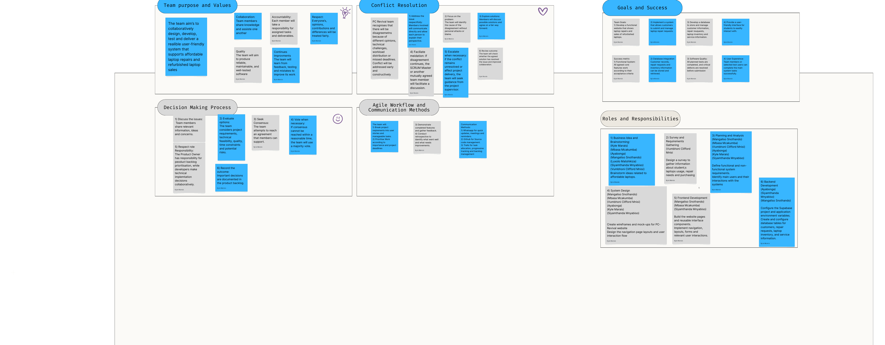
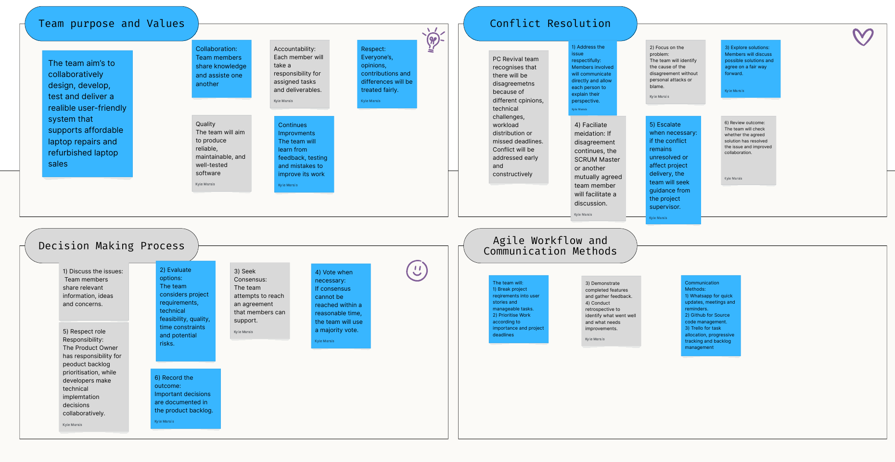
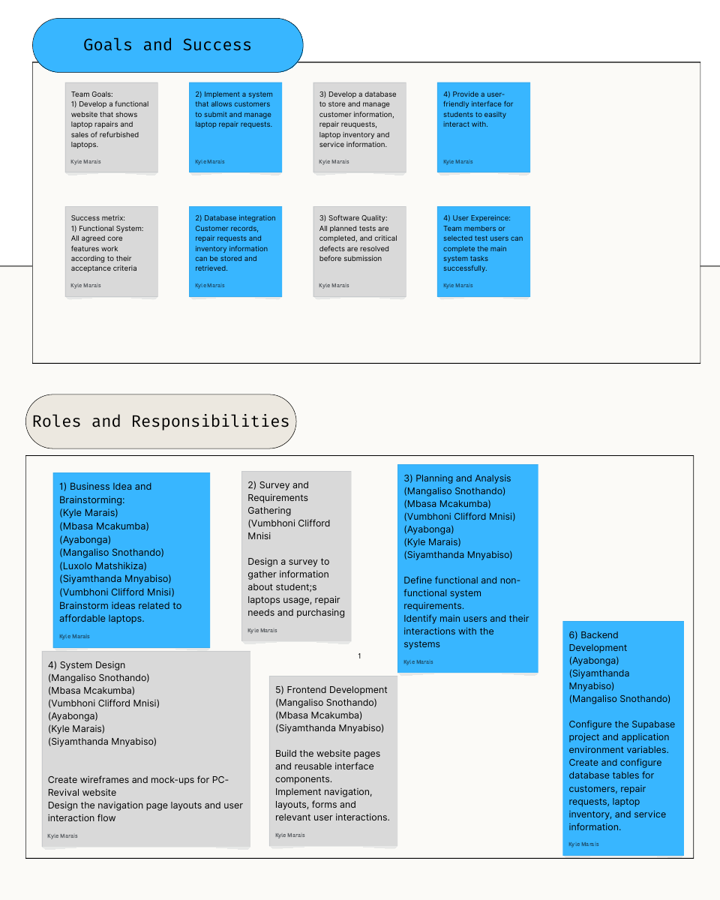
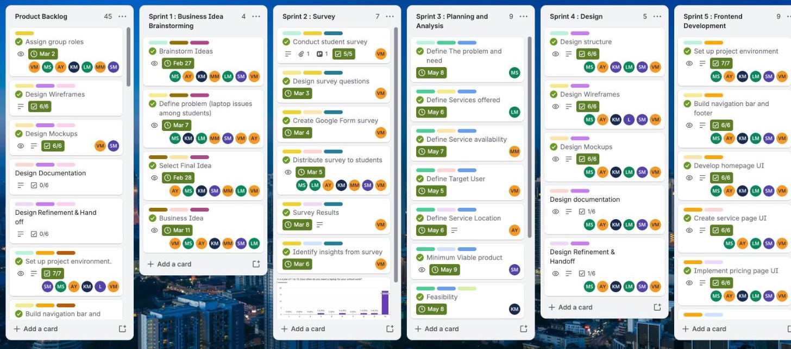
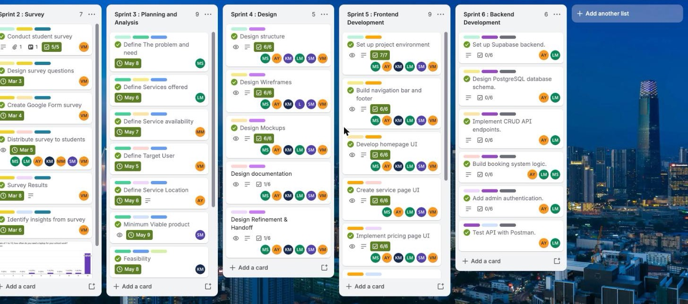

# Evidence

Screenshots that support the PC Revival Agile portfolio. Go back to the [main portfolio](../README.md).

## 1. Agile Team Charter

The PC Revival Team Charter was created by the team on a collaboration whiteboard. The full file is [PC-Revival-Team-Charter.pdf](../PC-Revival-Team-Charter.pdf).

### Whole charter

### Team purpose and values, decision making, conflict resolution, and workflow

### Goals and success, and roles and responsibilities

## 2. Trello board (Product Backlog, Sprint Backlog and Agile Logbook)

Live board: [PC Revival – Project Progress](https://trello.com/b/68sMqKP5/pc-revival-project-progress)

### Product Backlog and Sprints 1 to 5

### Sprints 2 to 6

